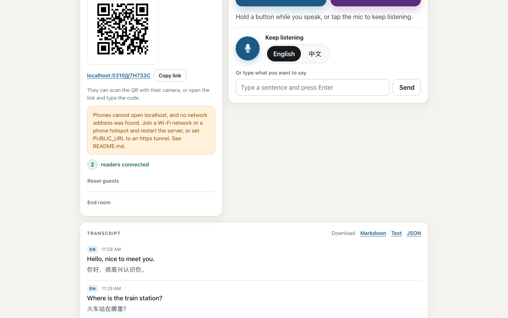

# live-translate

Live English and Chinese interpreting between two people in the same room: one device listens and transcribes, the other person reads the translation on their phone.



One device (the host) listens with the browser's speech recognition (English or Chinese) and shows a live transcript. The other person opens a link or scans a QR code on their phone and reads the translation as you talk (English to Simplified Chinese, Chinese to English, or both ways). You can download the whole conversation as a bilingual transcript (Markdown, text or JSON).

Node 20 or newer (CI uses the version in `.nvmrc`), no runtime dependencies (plain `node:http` and Server-Sent Events).

## Setup

```sh
npm install      # dev dependency only (playwright, for tests)
npm start        # node src/server.js, listens on PORT (default 3000)
npm test         # fast tests, no network
npm run test:e2e # browser end-to-end tests, screenshots in evidence/
```

Export the variables you need (see below), or copy `.env.example` to `.env`, fill it in, and start with `npm run start:env` (Node's `--env-file`; plain `npm start` does not read `.env`). `.env` files are git-ignored.

Open `http://localhost:3000` on the host device, choose a direction, and share the code or QR with the other person.

## Joining from a phone

When the host page is open on `localhost` and `PUBLIC_URL` is not set, the server uses this computer's private network address for the QR code and the join link (it prefers 192.168.x.x, then 10.x.x.x, then 172.16-31.x.x) and prints it at startup, for example `Guests join at http://192.168.1.5:3000 (same Wi-Fi, or a phone hotspot)`.

- Both devices must be on the same Wi-Fi. Hotel, office and guest Wi-Fi often block devices from reaching each other (client isolation). If the guest's phone cannot open the link, turn on a phone hotspot and connect the computer to it (the guest can use the same hotspot or the phone that runs it).
- The guest page needs no microphone, so plain http on the LAN is fine for reading and typing replies. Hold-to-speak on the guest phone appears only on https.
- From anywhere, or when the host itself is a phone, use an https tunnel. Phone browsers only allow the microphone on https, so a phone host needs this:

  ```sh
  cloudflared tunnel --url http://localhost:3000
  ```

  Then restart with `PUBLIC_URL` set to the printed `https://....trycloudflare.com` address and open the host page on that address.

## PUBLIC_URL and https

- Browsers only allow the microphone on a secure origin: `https://...` or `http://localhost`. Open the host page on `localhost` (on the machine running the server) or through https.
- `PUBLIC_URL` always wins: the QR code and join link use it, e.g. `PUBLIC_URL=https://your-tunnel.example.com npm start`.
- When the host page is on localhost and no private network address was found, the host page shows a warning.

## Environment variables

| Variable | Meaning |
| --- | --- |
| `PORT` | Port to listen on (default 3000). |
| `PUBLIC_URL` | Base URL guests use, e.g. `https://example.com`. Used for the QR code and join link. Without it, the server uses this computer's LAN (private network) address when the host page is open on localhost, and otherwise the address the host page was opened on. |
| `TRUST_PROXY` | Set to `1` only behind a reverse proxy you control. Then the client IP comes from `X-Forwarded-For` (first hop) and the scheme from `X-Forwarded-Proto`. Otherwise both headers are ignored. |
| `TRANSLATOR` | `mymemory` (default), `azure`, `deepl`, `google`, `libretranslate` or `mock` (offline, for tests). |
| `MYMEMORY_EMAIL` | Optional for MyMemory. Raises its small anonymous daily quota. The server warns at startup when it is missing. |
| `DEEPL_API_KEY` | Required for `TRANSLATOR=deepl`. Keys ending in `:fx` use the free API. |
| `AZURE_TRANSLATOR_KEY` | Required for `TRANSLATOR=azure`. |
| `AZURE_TRANSLATOR_REGION` | Optional for `TRANSLATOR=azure`: the resource region (e.g. `westeurope`), needed for regional and multi-service keys. |
| `GOOGLE_TRANSLATE_API_KEY` | Required for `TRANSLATOR=google` (paid). |
| `LIBRETRANSLATE_URL` | Required for `TRANSLATOR=libretranslate`, e.g. `http://localhost:5000`. Optional `LIBRETRANSLATE_API_KEY`, and `LIBRETRANSLATE_ZH=zh-Hans` for newer servers. |
| `TRANSLATE_DAILY_CHAR_LIMIT` | Characters per UTC day the server sends to the translator, across all rooms. Unset or `0` means unlimited. Set it when using a paid key. |
| `TRANSLATE_TIMEOUT_MS` | Provider timeout (default 8000). |

Keys are read from the environment only and are never sent to the browser. At startup the server warns when the chosen provider lacks its key or URL.

When a provider runs out of quota, rejects the key, or the daily budget is used up, lines are still saved and shown without a translation, and the host page shows a banner with the reason.

## Choosing a translator

The default, MyMemory, needs no key but its anonymous quota is about 5,000 characters per day per server IP, roughly 6 minutes of English speech. Setting `MYMEMORY_EMAIL` raises it to about 50,000 per day. For longer or regular use, a keyed provider with a free tier is better (numbers as of October 2026, check the provider's page):

- **Azure AI Translator F0**: 2 million characters per month free, the largest free tier. An Azure account is needed and asks for a card at signup. Create a Translator resource on the F0 tier, then run `TRANSLATOR=azure AZURE_TRANSLATOR_KEY=... AZURE_TRANSLATOR_REGION=westeurope npm start` (use your resource's region; leave the region out for a global resource).
- **DeepL API Free**: 500,000 characters per month. A card is required at signup. Run `TRANSLATOR=deepl DEEPL_API_KEY=...:fx npm start`.

On desktop Chrome with the built-in translator already downloaded, the host page translates on the device instead and sends the result with each line, so no translation service is used for those lines and no quota is spent. The footer says "Translated on this device" when that happens. The app never starts a model download.

When the quota runs out, the host sees a banner with the reason and these options.

## Limits

All limits are per server process and in memory.

| What | Limit | Answer when exceeded |
| --- | --- | --- |
| New rooms per client IP | 10 per hour (burst 10) | 429 |
| Final lines per client IP, across all rooms | burst 30, then 1 per second | 429 |
| Final lines per room | burst 20, then 2 per second | 429 (the host page retries with backoff) |
| Interim (live partial) updates per room | burst 20, then 5 per second | 429 (dropped; pages send about 3 per second) |
| Guest tokens | 20 per room, 30 new per client IP per hour (the host can reset them, see the API) | 429 |
| Open live streams (SSE) per client IP, across all rooms | 20 (the host page's own stream is exempt) | 429 |
| Open live streams (SSE) per room | 50 (the host page's own stream is exempt) | 429 |
| Unknown room codes per client IP | burst 30, then 1 every 2 seconds | 429 instead of 404 |
| Text per line | 2000 characters (a device translation: 4000) | 413 |
| Stored text per room | 200,000 characters or 5000 lines | 409 |
| Stored text across all rooms | 50,000,000 characters (freed when a room ends or expires) | 503 |
| Rooms | 10,000 at once | 503 |
| Translation budget | `TRANSLATE_DAILY_CHAR_LIMIT` per UTC day | line saved with `errorKind: "budget"` |
| Idle rooms | deleted after 12 hours without activity | 404 |

## Privacy

- Speech recognition runs in the host's browser. Chrome and Edge send the audio to Google or Microsoft for recognition, and Safari may send it to Apple. This server never receives audio.
- The recognized text, and every reply the guest types or speaks, is sent to this server and to the translation provider you configured, and stored the same way.
- Anyone with the room code can read along. Codes are 6 characters, and guessing is rate limited.
- Transcript key: `GET /transcript` requires `?token=` with the host token or the `readToken` that creating a room returns, otherwise 403. The host page's download links carry the host token. Guests have no download.
- Lines translated on the host device (Chrome's built-in translator) are not sent to a translation service. Every other line, including all guest replies, is.
- Rooms are kept in memory only. They are deleted after 12 hours idle, when the host taps "End room", or when the server restarts. Download your transcript before you leave.

## API (summary)

- `POST /api/rooms` `{direction: 'en-zh'|'zh-en'|'both'}` -> `201 {code, hostToken, readToken}`
- `GET /api/rooms/:code`, `DELETE /api/rooms/:code` `{hostToken}` -> 204 (every stream gets `event: end`)
- `GET /api/rooms/:code/qr.svg`, `GET /api/config` -> `{translator, joinBase}`
- `POST /api/rooms/:code/guests` `{}` -> `201 {guestToken}` (always `content-type: application/json`, also without a body)
- `DELETE /api/rooms/:code/guests` `{hostToken}` -> 204: revokes every guest token and frees the 20 slots (wrong token: 403). The host page has a "Reset guests" button; a guest page whose token was revoked asks for a new one.
- `POST /api/rooms/:code/segments` `{hostToken | guestToken, text, lang, final, translation?, wait?, clientId?}` -> `{id, text, translation, speaker[, pending][, error, errorKind]}`. An empty interim clears the live line. Guests reply in the other language of the room (any language in `both` rooms). `translation` (finals only, host token only; ignored for guests) is a translation made on the host device; the server then does not call the translator.
  - `wait` (finals): by default the answer waits for the translation. With `wait: false` it comes right after the line is stored and broadcast, as `{id, text, speaker, translation: null, pending: true}` (or with the translation when it is already known), and the translation follows on the event stream as the same-id update. The pages always send `wait: false`, so no POST stays open for a slow provider.
  - `clientId` (finals): 1 to 64 chars from `A-Z a-z 0-9 _ -` (else 400). A repeat with the same clientId from the same speaker returns the stored line (same id, current translation) and stores, translates and broadcasts nothing. The pages send a random one per line and reuse it on retries. Events of such lines carry `clientId`.
- `GET /api/rooms/:code/events` (SSE): `segment` {id, lang, text, translation, final, speaker, pending?, error?, errorKind?}. A final whose translation takes longer than 150 ms is sent at once with `pending: true` and again with the same id when the translation is ready. `presence` {readers} counts open streams except the host's own (`?role=host&token=<hostToken>`; `?role=host` without a valid token counts as a reader). `end` when the room is ended. Above the stream caps (see Limits) the request gets 429.
- `GET /api/rooms/:code/transcript?format=json|md|txt&token=<hostToken|readToken>` (403 without a valid token). Lines still translating show "(translating)". In Markdown, text is escaped so it cannot form links, images or HTML.

JSON request bodies must be sent with `content-type: application/json` (415 otherwise).

## Tests

- `npm test` runs the fast suite (Node's built-in test runner, about 120 tests). It needs no network: every test uses the offline `mock` translator. Some browser tests start headless Chromium through Playwright, so run `npx playwright install chromium webkit` once after `npm install`.
- The per-IP limit tests connect from `127.0.0.2`. Linux has that address; macOS only has `127.0.0.1` unless you add an alias, so on a Mac those 5 tests fail with `EADDRNOTAVAIL`. CI runs on Linux.
- `npm run test:e2e` runs the browser end-to-end scripts (host and guest pages, the grill scenarios, and a heavy QA pass in Chromium and WebKit).
- CI (`.github/workflows/ci.yml`) runs both suites and a gitleaks secret scan on every push and pull request, and every Monday.

## License

MIT, see [LICENSE](LICENSE). The bundled QR code generator in `src/qr.js` is by Project Nayuki, also MIT.
